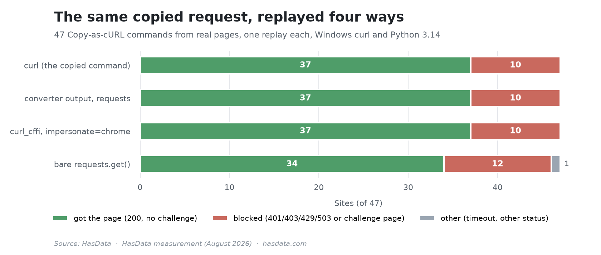

# Copy-as-cURL Round Trip Tests


What survives the trip from DevTools "Copy as cURL" to Python. The harness captures a real navigation request per site, then replays it four ways, the copied `curl` command itself, the `requests` code curlconverter produces from it, the same headers through `curl_cffi` with Chrome impersonation, and a bare `requests.get()` as the control. The findings back [our curl in Python guide](https://hasdata.com/blog/curl-in-python?utm_source=github&utm_medium=syndication&utm_campaign=curl-in-python&utm_content=curl-to-python-tests-readme).

## Table of Contents

- [Results](#results)
- [What Is Measured](#what-is-measured)
- [Project Structure](#project-structure)
- [Running It](#running-it)
- [Disclaimer](#disclaimer)
- [More Resources](#more-resources)

## Results

`results/curl_study.json` carries the per-site data for 47 sites, and the summary table:

| Method | Got the page | Blocked | Other |
|---|---:|---:|---:|
| `curl` (the copied command) | 37 | 10 | 0 |
| converter output, `requests` | 37 | 10 | 0 |
| `curl_cffi`, `impersonate="chrome"` | 37 | 10 | 0 |
| bare `requests.get()` | 34 | 12 | 1 |

The verdicts, drawn:



The conversion itself lost nothing. Zero of the captured headers were dropped across all commands, body sizes matched byte for byte on 35 of the 37 sites both methods fetched (the two news homepages differed only by their own dynamic markup between requests), and the converter's output blocked exactly where the original `curl` blocked. The gap belongs to the bare control, which lost three more sites for want of the headers.

## What Is Measured

Each site opens once in headless Chrome, the navigation request is captured exactly as DevTools would copy it, and the four replays record status, body size, a challenge-page check, timing, and how many headers survived the conversion. `commands/` keeps every captured pair, the `.sh` as copied and the `.py` the converter produced, 47 of each.

## Project Structure

The pairs are the dataset, the harness reproduces them.

```
curl-to-python-tests/
├── curl_study.py    # capture and four-way replay harness
├── examples/        # the five client variants from the article
├── commands/        # 47 captured .sh / converted .py pairs
└── results/         # per-site JSON and the summary
```

The captures come from a fresh headless context, so cookies and session tokens don't ride along.

## Running It

The capture needs a browser, the replays need the two clients, and the harness needs a system `curl` on PATH.

```bash
pip install requests "httpx[http2]" curl_cffi pycurl playwright
playwright install chromium
python curl_study.py
```

The harness fetches live sites, so counts drift as sites change their defences.

## Disclaimer

The study fetches each site's public homepage once per method and records how the site answers. Whether and how such collection is appropriate depends on jurisdiction, the site, and the use, and nothing in this repository is legal advice. [Is Web Scraping Legal?](https://hasdata.com/blog/is-web-scraping-legal?utm_source=github&utm_medium=syndication&utm_campaign=curl-in-python&utm_content=curl-to-python-tests-readme) covers how we think about the question.

## More Resources

- [How to Use cURL in Python](https://hasdata.com/blog/curl-in-python?utm_source=github&utm_medium=syndication&utm_campaign=curl-in-python&utm_content=curl-to-python-tests-readme), the guide these findings back
- [User Agents for Web Scraping](https://hasdata.com/blog/user-agents-for-web-scraping?utm_source=github&utm_medium=syndication&utm_campaign=curl-in-python&utm_content=curl-to-python-tests-readme), why the header set decides the outcome
